  
  
  

### About

I build systems that answer in real time and hold up in production: AI voice agents on real phone lines, data pipelines, and web & mobile apps.

- **Now** — real-time AI voice agents (telephony ↔ Realtime LLMs) at Somtech
- **Studied** — computer science at UQAM (Montréal), ESMT (Dakar)
- **Care about** — tests that guard what matters, readable architecture, interfaces people enjoy

### Selected work

  
  
  
  
  
  

### Stack

  

### Activity

  <picture>
    <source media="(prefers-color-scheme: dark)" srcset="https://raw.githubusercontent.com/Mamadoulaminedabo/Mamadoulaminedabo/output/snake-dark.svg"/>
    
  </picture>

Includes contributions to private company repositories, counted without any public code.

